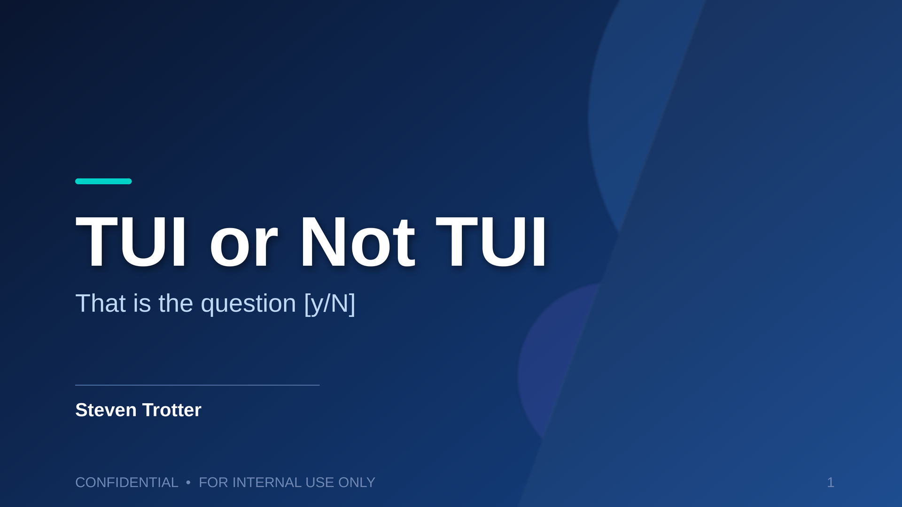
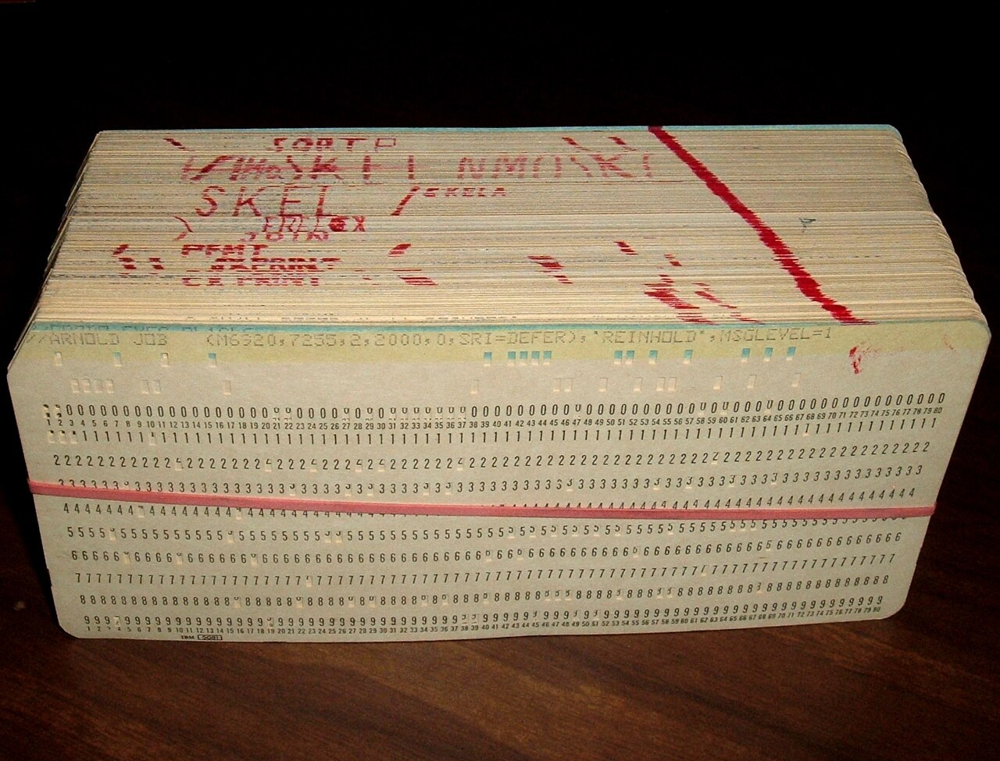
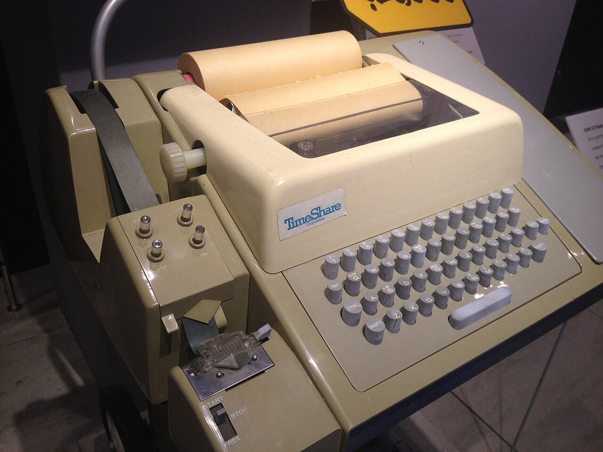
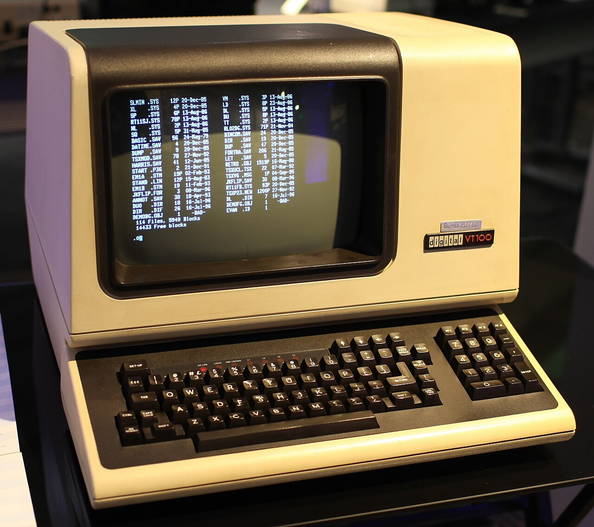
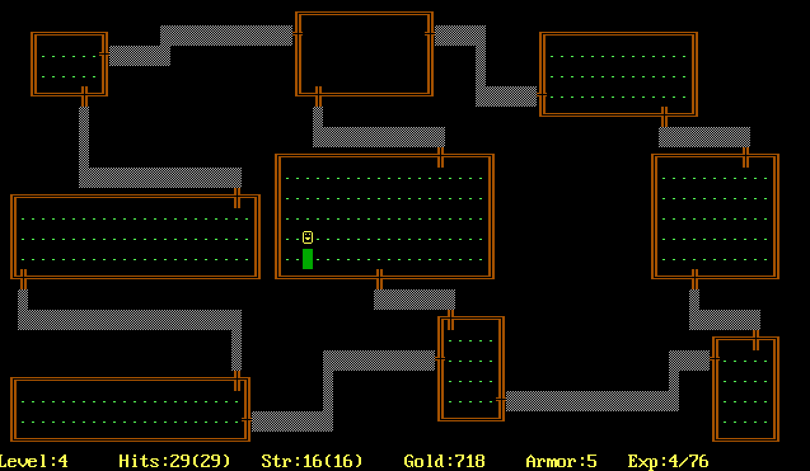
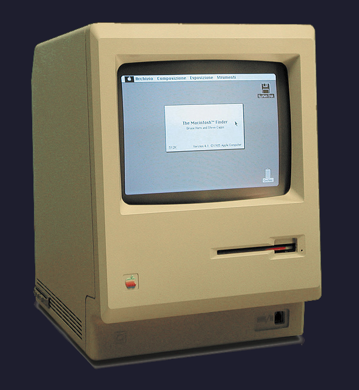
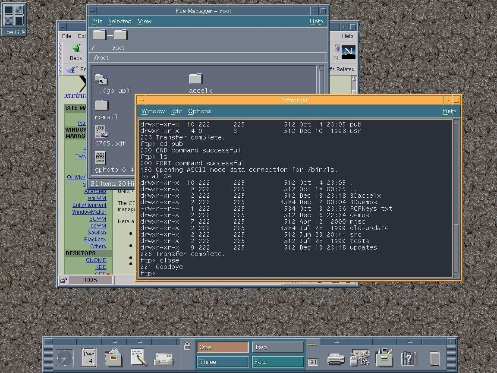
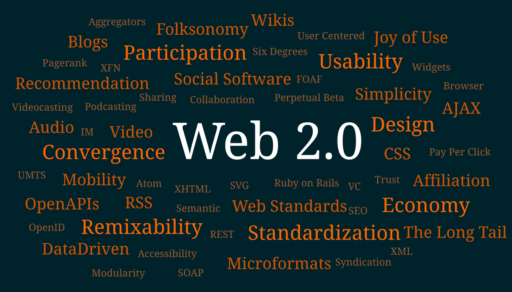
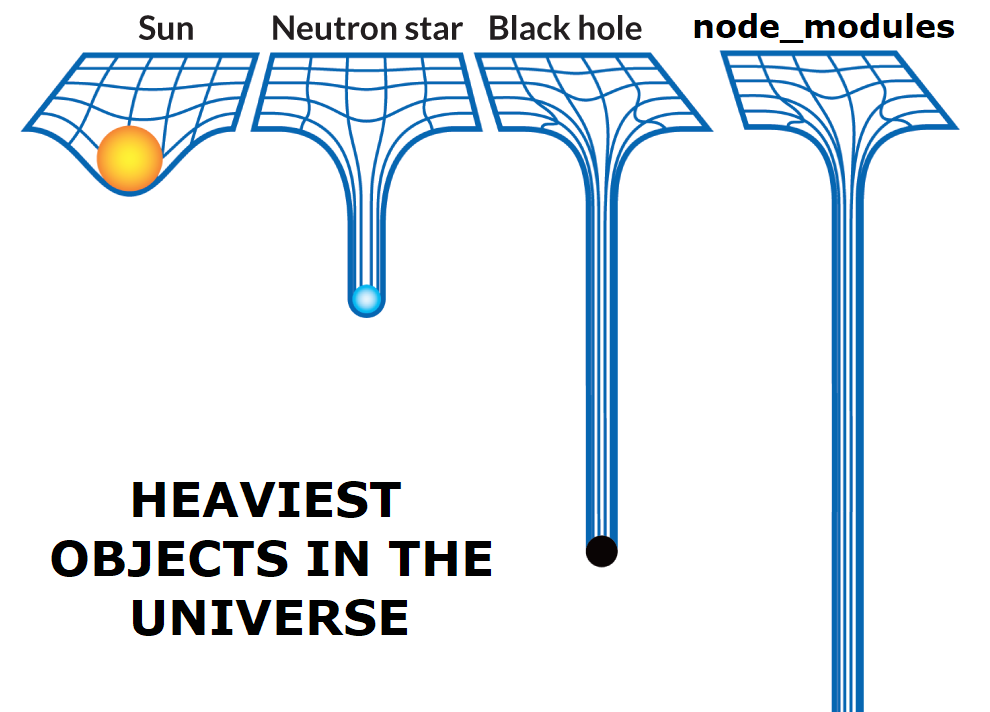

---
theme:
  name: catppuccin-mocha
  override:
    footer:
      style: template
      left: "TUI or Not TUI"
      right: "{current_slide} / {total_slides}"
---

<!-- no_footer -->



<!-- end_slide -->

<!-- no_footer -->
<!-- new_lines: 3 -->

```text +no_background
████████╗██╗   ██╗██╗     ██████╗ ██████╗
╚══██╔══╝██║   ██║██║    ██╔═══██╗██╔══██╗
   ██║   ██║   ██║██║    ██║   ██║██████╔╝
   ██║   ██║   ██║██║    ██║   ██║██╔══██╗
   ██║   ╚██████╔╝██║    ╚██████╔╝██║  ██║
   ╚═╝    ╚═════╝ ╚═╝     ╚═════╝ ╚═╝  ╚═╝

███╗   ██╗ ██████╗ ████████╗    ████████╗██╗   ██╗██╗
████╗  ██║██╔═══██╗╚══██╔══╝    ╚══██╔══╝██║   ██║██║
██╔██╗ ██║██║   ██║   ██║          ██║   ██║   ██║██║
██║╚██╗██║██║   ██║   ██║          ██║   ██║   ██║██║
██║ ╚████║╚██████╔╝   ██║          ██║   ╚██████╔╝██║
╚═╝  ╚═══╝ ╚═════╝    ╚═╝          ╚═╝    ╚═════╝ ╚═╝
```

<!-- alignment: center -->

_Sorry, wrong slides. That was the last GUI you'll see in this talk._

**Steven Trotter**

<!-- end_slide -->

# Outline of Talk

- Who am I and what is this talk about?
<!-- pause -->
- How did we get here? (A very short history of UIs)
<!-- pause -->
- The mad stuff people have built in a terminal
<!-- pause -->
- The genuinely useful stuff
<!-- pause -->
- What makes a good TUI good?
<!-- pause -->
- How does a TUI actually work?
<!-- pause -->
- Let's build one (twice)

<!-- end_slide -->

# Who am I and what is this talk about?

- 15+ years experience in software development, platform, architecture, etc
<!-- pause -->
- I work at **Wyser AI** (`wyserai.com`), building AI-for-good software for the advice sector
<!-- pause -->
- I live in the terminal: Neovim, tmux, codex, and this presentation
<!-- pause -->
- Yes, this is a TUI. It's called `presenterm`, these slides are just a markdown file
<!-- pause -->
- I've written a few TUIs and spent far too long playing around with terminals

<!-- pause -->

This talk is a fun tour of some genuinely mad things people have built in the
terminal, a look at what makes the good ones good, and a demo of how you'd write
your own. **It's much more straightforward than you think.**

<!-- end_slide -->

<!-- jump_to_middle -->
<!-- alignment: center -->

# How did we get here?

_A short history of user interfaces_

<!-- end_slide -->

# 1950s-70s: Punch cards

<!-- column_layout: [2, 3] -->

<!-- column: 0 -->



_A program deck, c. 1969. Photo: ArnoldReinhold, CC BY-SA 3.0_

<!-- column: 1 -->

- Older than computers: looms, the 1890 US census
- One line of code per card, **80 columns** wide
- Typo? Re-punch the whole card
- Hand the deck to an operator... and **wait**

<!-- pause -->

- Dropped it? Hope you used the sequence numbers
- (Or drew a diagonal stripe across the top)

<!-- pause -->

Those 80 columns are a big reason your terminal still defaults to 80 wide.

<!-- reset_layout -->

<!-- end_slide -->

# 1960s: The Teletype

<!-- column_layout: [2, 3] -->

<!-- column: 0 -->



_Teletype Model 33 ASR. Photo: ArnoldReinhold, CC BY-SA 3.0_

<!-- column: 1 -->

- A keyboard bolted to a printer
- Finally **interactive**: you type, it answers
- The UI was **paper**, at 10 characters a second
- No screen, so no redrawing. Just print more lines

<!-- pause -->

It's still everywhere:

- `tty` = **T**ele**TY**pe
- `\r` returns the print head, `\n` feeds the paper
- `Ctrl-G` rang an actual, physical bell

<!-- reset_layout -->

<!-- end_slide -->

# 1978: DEC VT100

<!-- column_layout: [2, 3] -->

<!-- column: 0 -->



_Photo: Jason Scott, CC BY 2.0_

<!-- column: 1 -->

- A **screen** and a **cursor** you could move
- 80×24 characters (sound familiar?)
- Driven by **ANSI escape codes**: `ESC[5;10H`

<!-- pause -->

- Glass, not paper: you can _rewrite_ the screen
- Full screen apps like `vi` take off

<!-- pause -->

Your terminal emulator today is still, at heart, **pretending to be a VT100**.
Its escape codes (plus a few later additions) are coming back in Part 3.

<!-- reset_layout -->

<!-- end_slide -->

# 1978-80: curses and Rogue

<!-- column_layout: [2, 3] -->

<!-- column: 0 -->



_Rogue (PC version). Public domain screenshot_

<!-- column: 1 -->

- Every terminal had **different** escape codes
- `termcap`: "how does _this_ terminal do X?"
- **`curses`** (Ken Arnold, Berkeley) does the rest
- Draw to a buffer, it sends the minimal updates

<!-- pause -->

- Its most famous early user: **Rogue**
- Random dungeons, permadeath, `@` is you
- Named a whole genre: the **roguelike**

<!-- reset_layout -->

<!-- end_slide -->

# 1984: Apple Macintosh

<!-- column_layout: [2, 3] -->

<!-- column: 0 -->



_Photo: Grm wnr, CC BY-SA 3.0_

<!-- column: 1 -->

- Pioneered at Xerox PARC, made mainstream by Apple
- **W**indows, **I**cons, **M**enus, **P**ointer
- 512×342 pixels, black and white, plus a mouse

<!-- pause -->

- No commands to remember: you can _see_ them
- Genuinely revolutionary for normal people

<!-- pause -->

And the terminal becomes "that thing nerds use".

<!-- reset_layout -->

<!-- end_slide -->

# 1990s: Native GUIs everywhere

<!-- column_layout: [2, 3] -->

<!-- column: 0 -->



_CDE on Unix. Screenshot: User230792, CC BY-SA 3.0_

<!-- column: 1 -->

- Windows: Win32, then MFC
- Unix: X11, Motif, CDE
- Mac: the Toolbox
- Then Tk, Qt, GTK, Java Swing...

<!-- pause -->

- Three platforms? **Write it three times**
- Or Java: "write once, run anywhere"
- (Write once, look weird everywhere)

<!-- reset_layout -->

<!-- end_slide -->

# 2000s: "Just make it a web app"

<!-- column_layout: [2, 3] -->

<!-- column: 0 -->



_Web 2.0 map. Markus Angermeier, CC BY-SA 2.5_

<!-- column: 1 -->

- Gmail (2004), Google Maps (2005): **AJAX**!
- jQuery, then a new JS framework every week
- No installs, works everywhere, ship any time

<!-- pause -->

- But now it lives in a **browser tab**
- Needs a server, a network and a build step
- Native look and feel? What's that?

<!-- reset_layout -->

<!-- end_slide -->

# 2013+: "Just put the web app in a desktop app"

<!-- column_layout: [2, 3] -->

<!-- column: 0 -->



_The classic. Origin unknown, via r/ProgrammerHumor_

<!-- column: 1 -->

- **Electron**: born as "Atom Shell" for GitHub's Atom
- Web app + Node.js + **a whole copy of Chromium**
- VS Code, Slack, Discord...

<!-- pause -->

- Web devs can ship desktop apps. A real win!
- But every app ships its own browser
- Even hello world ships **a whole browser**

<!-- reset_layout -->

<!-- end_slide -->

<!-- jump_to_middle -->
<!-- alignment: center -->

Now you need a browser, a build step and **400MB of `node_modules`** to render a list.

<!-- pause -->

# It doesn't have to be like this.

<!-- end_slide -->

# Meanwhile, the terminal quietly got good

<!-- incremental_lists: true -->

- **GPU accelerated terminals**: Alacritty, kitty, WezTerm, Ghostty
- **24-bit "truecolor"**: 16 million colours, not 16
- **Unicode and Nerd Fonts**: box drawing, braille, icons, emoji 🎉
- **Graphics protocols**: kitty, sixel, iTerm2 (proper pixels in a terminal!)
- **Kitty keyboard protocol**: unambiguous keys, every modifier, even key-up events
- **Mouse support**, bracketed paste, focus events, synchronised output
- **Great libraries** in every language (more on this later)

<!-- incremental_lists: false -->

<!-- end_slide -->

<!-- jump_to_middle -->
<!-- alignment: center -->

# Part 1: The mad stuff

<!-- end_slide -->

# Did you know you can play Doom in a terminal?

<!-- column_layout: [1, 1] -->

<!-- column: 0 -->

## doom-cli

- Unicode block characters as "pixels"
- Up to 6 pixels per character cell
- 24-bit colour, and it works over SSH
- No key-up events, so it guesses them
  (the kitty keyboard protocol fixes this)

```bash
./doomgeneric -iwad doom1.wad
```

<!-- column: 1 -->

## terminal-doom

- Written in Zig
- Uses the **kitty graphics protocol**
- Real pixels, full framerate, sound
- In. Your. Terminal.

<!-- reset_layout -->

<!-- pause -->

<!-- alignment: center -->

**Demo time** 🔫

<!-- end_slide -->

# You can browse the web in a terminal

<!-- column_layout: [1, 1] -->

<!-- column: 0 -->

## Carbonyl

- **Actual Chromium**, in your terminal
- Uses half-block characters for "pixels"
- Plays YouTube. Yes, really.

<!-- column: 1 -->

## Browsh

- Headless Firefox behind the scenes
- Turns pages into text + colour blocks
- Also has a "browse over SSH" mode

## Old school

- `lynx`, `w3m`, `links`
- Still going, still fast

<!-- reset_layout -->

```bash
podman run --rm -ti fathyb/carbonyl \
  https://en.wikipedia.org/wiki/Text-based_user_interface
```

<!-- end_slide -->

# Maps, video and... coffee?

```bash
# The whole world, in OpenStreetMap, zoomable, in your terminal
telnet mapscii.me
```

<!-- pause -->

```bash
# Play any video as coloured text (or real pixels with --vo=kitty / --vo=sixel)
mpv --vo=tct some_video.mp4
```

<!-- pause -->

```bash
# An actual coffee shop. You order. They ship you coffee.
ssh terminal.shop
```

<!-- pause -->

```bash
# Star Wars Episode IV in ASCII (if it's up today...)
telnet towel.blinkenlights.nl
```

<!-- end_slide -->

# And the gloriously pointless

| Command        | What it does                                              |
| -------------- | --------------------------------------------------------- |
| `sl`           | A steam locomotive drives past when you mistype `ls`      |
| `cmatrix`      | You're in the Matrix now                                  |
| `cbonsai`      | Grows you a little bonsai tree                            |
| `asciiquarium` | An aquarium. With fish. And sharks                        |
| `pipes.sh`     | The Windows 95 pipes screensaver, but better              |
| `lolcat`       | Pipe anything into it, now it's a rainbow                 |

<!-- pause -->

And don't forget the classics: **NetHack**, **Dwarf Fortress** and of course
**Rogue**, which gave an entire game genre its name.

<!-- end_slide -->

<!-- jump_to_middle -->
<!-- alignment: center -->

# Part 2: The genuinely useful stuff

<!-- end_slide -->

# TUIs I actually use every day

| Tool               | What                                     | Built with      |
| ------------------ | ---------------------------------------- | --------------- |
| `lazygit`          | Git, but you can actually see it         | Go              |
| `k9s`              | Kubernetes without 400 `kubectl` calls   | Go              |
| `bottom` (`btm`)   | Easily the best system monitor going     | Rust (Ratatui)  |
| `yazi`             | Blazing fast, async file manager         | Rust (Ratatui)  |
| `ncdu`             | "What's eating my disk?"                 | C / Zig         |
| `posting`          | HTTP client, like Postman without bloat  | Python (Textual)|
| `harlequin`        | SQL IDE in the terminal                  | Python (Textual)|
| `visidata`         | Spreadsheet for any CSV/JSON/SQLite      | Python          |
| Neovim / Helix     | Editors, obviously                       | C / Rust        |

<!-- pause -->

Oh, and a fair few of the AI coding agents everyone's using right now? **TUIs.**

<!-- end_slide -->

# The AI coding agents? Also TUIs

| Agent         | From                 | Built with                                |
| ------------- | -------------------- | ----------------------------------------- |
| Claude Code   | Anthropic            | TypeScript + React                        |
| Codex CLI     | OpenAI               | Rust (Ratatui)                            |
| Gemini CLI    | Google               | TypeScript (Ink, i.e. React)              |
| OpenCode      | Open source          | TypeScript (OpenTUI, with a Zig core)     |
| pi            | Open source          | TypeScript (its own `pi-tui` library)     |

<!-- pause -->

Why the terminal?

<!-- incremental_lists: true -->

- It's **where the code already is**: your shell, git, tests, `$EDITOR`
- LLMs produce **streams of text**. Terminals are very good at streams of text
- Runs over SSH, in a container, in tmux on a box somewhere
- Scriptable too: `claude -p "..."` and `codex exec "..."` work headless

<!-- incremental_lists: false -->

<!-- pause -->

And look at that last column: React, Ratatui, Zig. **Every approach from Part 4, in production.**

<!-- end_slide -->

# What makes a good TUI good?

<!-- incremental_lists: true -->

- **It's instant.** Starts in milliseconds and never blocks the UI on I/O
- **Keyboard first, but discoverable.** Show the keys (`lazygit`'s bottom bar, `?` for help)
- **Familiar keybindings.** `j`/`k`, `/` to search, `q` to quit, and make them configurable
- **Respects your terminal.** Uses your colour scheme, handles resizing, honours `NO_COLOR`
- **Leaves no mess.** Always restores the terminal, _even when it crashes_
- **Works everywhere.** Over SSH, inside tmux, on a tiny laptop screen
- **Degrades gracefully.** No Nerd Font? 256 colours? Still usable
- **Plays nicely with others.** Reads stdin, writes stdout, opens your `$EDITOR`

<!-- incremental_lists: false -->

<!-- end_slide -->

<!-- jump_to_middle -->
<!-- alignment: center -->

# Part 3: How does a TUI actually work?

<!-- end_slide -->

# A terminal is just a grid of characters

```text
┌────┬────┬────┬────┬────┬────┬────┬────┐
│ H  │ e  │ l  │ l  │ o  │    │ 👋 │    │   Each cell has:
├────┼────┼────┼────┼────┼────┼────┼────┤     - a character
│    │    │    │    │    │    │    │    │     - foreground colour
├────┼────┼────┼────┼────┼────┼────┼────┤     - background colour
│    │    │ █  │    │    │    │    │    │     - bold/italic/underline...
└────┴────┴────┴────┴────┴────┴────┴────┘
```

<!-- pause -->

You control it by printing **escape codes**: special byte sequences starting with `ESC` (`\x1b`)

```bash +exec
printf '\e[1;31mbold red\e[0m  \e[4;32munderlined green\e[0m  \e[7mreversed\e[0m\n'
printf '\e[38;2;255;120;0mtruecolor orange\e[0m  \e[3;38;2;120;160;255mitalic blue\e[0m\n'
for i in $(seq 0 15); do printf "\e[48;5;${i}m   "; done; printf '\e[0m\n'
```

<!-- end_slide -->

# The handful of escape codes you actually need

| Escape code      | What it does                                    |
| ---------------- | ----------------------------------------------- |
| `\x1b[2J`        | Clear the screen                                |
| `\x1b[H`         | Move cursor to top left                         |
| `\x1b[5;10H`     | Move cursor to row 5, column 10                 |
| `\x1b[1;35m`     | Bold, magenta text (`\x1b[0m` to reset)         |
| `\x1b[7m`        | Reverse video (great for "selected" items)      |
| `\x1b[?25l`      | Hide the cursor (`h` to show again)             |
| `\x1b[?1049h`    | Switch to the **alternate screen** (`l` to leave) |

<!-- pause -->

The alternate screen is why `vim`/`less`/`htop` vanish when you quit and your
scrollback is still there.

<!-- end_slide -->

# Input: cooked vs raw mode

By default the terminal is in **cooked** mode:

- It echoes what you type
- It buffers until you hit Enter
- It handles Ctrl-C, backspace etc. for you

<!-- pause -->

For a TUI we want **raw** mode:

- No echo, no buffering. Every key press arrives immediately
- Keys are just bytes: `j` is `b"j"`, ↓ is `b"\x1b[B"`, Ctrl-C is `b"\x03"`
- And now _you're_ responsible for everything (including putting it back!)

<!-- end_slide -->

# Every TUI ever is this loop

```text
          ┌──────────────────────────┐
          │                          │
          ▼                          │
   ┌─────────────┐                   │
   │    DRAW     │  render state     │
   │  the state  │  to the screen    │
   └──────┬──────┘                   │
          ▼                          │
   ┌─────────────┐                   │
   │    WAIT     │  key press, mouse,│
   │  for input  │  resize, timer... │
   └──────┬──────┘                   │
          ▼                          │
   ┌─────────────┐                   │
   │   UPDATE    │  change the state │
   │  the state  ├───────────────────┘
   └─────────────┘
```

<!-- pause -->

That's it. That's the whole architecture. Everything else is detail.

<!-- end_slide -->

<!-- jump_to_middle -->
<!-- alignment: center -->

# Part 4: Let's build one

<!-- end_slide -->

# Version 1: zero dependencies (Python): drawing

```python {1|3-9|11-13|14-21} +line_numbers
import os, sys, termios, tty

def entries(path):                                  # "..", then folders, then files
    try:
        names = [n + "/" if os.path.isdir(os.path.join(path, n)) else n
                 for n in os.listdir(path)]
    except OSError:                                 # e.g. permission denied
        names = []
    return [".."] + sorted(names, key=lambda n: (not n.endswith("/"), n))

def draw(path, items, selected):
    out = "\x1b[H\x1b[2J"                          # cursor home, clear screen
    out += f"\x1b[1;35m  {path}\x1b[0m\r\n\r\n"    # bold magenta title
    for i, item in enumerate(items):
        if i == selected:
            out += f"\x1b[7m > {item} \x1b[0m\r\n"  # reverse video
        else:
            out += f"   {item}\r\n"
    out += "\r\n\x1b[2m  j/k move, Enter open, Backspace up, q quit\x1b[0m"
    sys.stdout.write(out)
    sys.stdout.flush()
```

<!-- pause -->

Note the `\r\n`: in raw mode a newline doesn't go back to the start of the line!

<!-- end_slide -->

# Version 1: zero dependencies (Python): the loop

```python {1-6|7-11|12-22|23-26} +line_numbers
def main():
    fd = sys.stdin.fileno()
    old = termios.tcgetattr(fd)
    sys.stdout.write("\x1b[?1049h\x1b[?25l")       # alt screen, hide cursor
    try:
        tty.setraw(fd)                              # no echo, no line buffering
        path, selected = os.getcwd(), 0
        while True:
            items = entries(path)
            draw(path, items, selected)             # DRAW
            key = os.read(fd, 3)                    # WAIT (arrow keys are 3 bytes)
            if key in (b"q", b"\x03"):              # q or Ctrl-C
                break
            if key in (b"j", b"\x1b[B"):            # UPDATE
                selected = min(selected + 1, len(items) - 1)
            if key in (b"k", b"\x1b[A"):
                selected = max(selected - 1, 0)
            if key in (b"\r", b"l") and items[selected].endswith(("/", "..")):
                path = os.path.normpath(os.path.join(path, items[selected]))
                selected = 0
            if key in (b"\x7f", b"h"):              # Backspace
                path, selected = os.path.dirname(path), 0
    finally:
        termios.tcsetattr(fd, termios.TCSADRAIN, old)
        sys.stdout.write("\x1b[?25h\x1b[?1049l")   # show cursor, main screen
        sys.stdout.flush()
```

<!-- pause -->

**Demo time:** `python3 demo/raw/list.py`

<!-- end_slide -->

# That works! But...

<!-- incremental_lists: true -->

- We redraw **the entire screen** on every key press
- What happens when the window is **resized**?
- Layout? Borders? Scrolling when the list is longer than the screen?
- `"👋"` is 1 character but **2 cells** wide. `"é"` might be 1 or 2 code points...
- Windows doesn't have `termios`
- Mouse input, paste, focus events, `ESC` vs `Alt` key ambiguity...

<!-- incremental_lists: false -->

<!-- pause -->

**This is what TUI libraries are for.**

<!-- end_slide -->

# Pick your weapon

| Language       | Library                     | Style                               |
| -------------- | --------------------------- | ----------------------------------- |
| Rust           | **Ratatui**                 | Immediate mode widgets              |
| Go             | **Bubble Tea** (+ Lip Gloss)| The Elm architecture                |
| Go             | tview                       | Classic retained widgets            |
| Python         | **Textual**                 | CSS-styled widgets, can run in a browser! |
| JavaScript/TS  | Ink                         | React components... in a terminal   |
| C++            | FTXUI                       | Functional, declarative             |
| C#             | Terminal.Gui                | Full windowing toolkit              |
| C              | ncurses / notcurses         | The OG / the very modern            |

<!-- pause -->

They all give you the same thing: **a buffer to draw into, layouts, widgets, and events.**

<!-- end_slide -->

# Version 2: Ratatui (Rust): the main loop

```rust {1-6|8-10|11-17} +line_numbers
fn main() -> std::io::Result<()> {
    let mut terminal = ratatui::init(); // raw mode + alternate screen
    let result = run(&mut terminal);
    ratatui::restore(); // put the terminal back how we found it
    result
}

fn run(terminal: &mut DefaultTerminal) -> std::io::Result<()> {
    let mut dir = std::env::current_dir()?; // which folder we're in
    let mut state = ListState::default().with_selected(Some(0)); // which row is selected
    loop {
        terminal.draw(|frame| draw(frame, &dir, &mut state))?; // DRAW
        let keep_going = handle_events(&mut dir, &mut state)?; // WAIT + UPDATE
        if !keep_going {
            return Ok(());
        }
    }
}
```

<!-- end_slide -->

# Version 2: Ratatui (Rust): drawing

```rust {1-3|5-9|11-15} +line_numbers
fn draw(frame: &mut Frame, dir: &Path, state: &mut ListState) {
    let layout = Layout::vertical([Min(0), Length(1)]); // list, help bar
    let [main, help] = layout.areas(frame.area());

    let title = format!(" {} ", dir.display());
    let list = List::new(list_dir(dir))
        .block(Block::bordered().title(title.bold().magenta()))
        .highlight_style(Style::new().reversed())
        .highlight_symbol("> ");

    frame.render_stateful_widget(list, main, state);
    frame.render_widget(
        Paragraph::new(" j/k move, Enter open, Backspace up, q quit").dim(),
        help,
    );
}
```

<!-- pause -->

- Layout is constraints: "the help bar is 1 line, the list gets the rest"
- Widgets are just values, you build them fresh every frame
- Resizing just works, `frame.area()` is always the current size
- `list_dir()` is plain `std::fs`, nothing TUI-specific. Yes, we re-read the folder every frame. It's fine

<!-- end_slide -->

# Version 2: Ratatui (Rust): input

```rust {1-9|10-20|21-24} +line_numbers
fn handle_events(dir: &mut PathBuf, state: &mut ListState) -> std::io::Result<bool> {
    if let Event::Key(key) = event::read()? {
        if key.kind != KeyEventKind::Press {
            return Ok(true);
        }
        match key.code {
            KeyCode::Char('q') | KeyCode::Esc => return Ok(false),
            KeyCode::Char('j') | KeyCode::Down => state.select_next(),
            KeyCode::Char('k') | KeyCode::Up => state.select_previous(),
            KeyCode::Enter | KeyCode::Char('l') => {
                let name = &list_dir(dir)[state.selected().unwrap_or(0)];
                if name == ".." {
                    dir.pop();
                } else if name.ends_with('/') {
                    dir.push(name.trim_end_matches('/'));
                } else {
                    return Ok(true); // it's a file, nothing to open
                }
                state.select(Some(0));
            }
            KeyCode::Backspace | KeyCode::Char('h') => {
                dir.pop();
                state.select(Some(0));
            }
            _ => {}
        }
    }
    Ok(true)
}
```

<!-- pause -->

No byte sequences. No `termios`. Works on Linux, macOS **and Windows**.

<!-- pause -->

**Demo time:** `cargo run --release --manifest-path demo/ratatui_list/Cargo.toml`

<!-- end_slide -->

# The clever bit: "immediate mode" + diffing

- Every frame you describe **the whole UI** from your state. No widget tree to keep in sync
<!-- pause -->
- Ratatui renders that into an in-memory buffer of cells
<!-- pause -->
- Then it **diffs** it against the previous frame and only sends what changed

<!-- pause -->

Pressing `j` in our app sends roughly this. Just two lines, not the whole screen:

```text
ESC[2;2H  ..                    ← un-highlight the old row
ESC[3;2H ESC[7m> asciiquarium/  ← highlight the new row
```

<!-- pause -->

It's the same idea as React's virtual DOM. Just without the DOM. Or the 400MB.

<!-- end_slide -->

# The scoreboard

| | Raw Python | Ratatui | "Just use Electron" |
| --- | --- | --- | --- |
| Lines of code | ~40 | ~65 | You'll need a bigger slide |
| Dependencies | 0 | 1 | Yes |
| Size | 1.6 KB script | ~700 KB binary | Starts at a Chromium |
| Startup time | Instant | Instant | ☕ |
| Works over SSH | ✅ | ✅ | ❌ |

<!-- end_slide -->

# Where to go from here

<!-- incremental_lists: true -->

- **Async**: tick events and background tasks so the UI never freezes (`tokio` + `crossterm`'s `EventStream`)
- **Panic hooks**: `ratatui::init()` sets one up so a crash still restores the terminal
- **Testing**: render into a `TestBackend` and snapshot the buffer. UI tests that are just strings!
- **Serve it over SSH**: Charm's `wish` (Go) or `russh` (Rust). Hello `terminal.shop`
- **Serve it in a browser**: Textual apps can be served to a web browser too
- **Steal ideas**: read the source of `lazygit`, `yazi`, `bottom`, `gitui`

<!-- incremental_lists: false -->

<!-- end_slide -->

# Takeaways

<!-- incremental_lists: true -->

- The terminal is a **seriously capable** platform. People run Doom and Chromium in it
- The best TUIs are **fast, keyboard first, discoverable, and respectful** of your terminal
- Under the hood it's just **a grid, some escape codes, raw mode and a loop**
- With a library you get layout, widgets, diffing and cross platform for free
- Next time you need a little internal tool... **maybe it doesn't need a browser**

<!-- incremental_lists: false -->

<!-- end_slide -->

<!-- jump_to_middle -->
<!-- alignment: center -->

# Thank you! Questions?

<!-- pause -->

_`q` to quit_

<!-- end_slide -->

# Further reading

**History and how terminals work**

- _The TTY demystified_, Linus Åkesson: `linusakesson.net/programming/tty`
- _Digital VT100 User Guide_ and more, Paul Flo Williams: `vt100.net`
- The curses paper, Ken Arnold: `docs-archive.freebsd.org/44doc/psd/19.curses`
- _In the Beginning... Was the Command Line_, Neal Stephenson (1999)

**Building TUIs**

- _Build Your Own Text Editor_: `viewsourcecode.org/snaptoken/kilo`
- _XTerm Control Sequences_: `invisible-island.net/xterm/ctlseqs/ctlseqs.html`
- Ratatui concepts (rendering, layout, diffing): `ratatui.rs/concepts`
- _The Elm Architecture_: `guide.elm-lang.org/architecture`
- Unicode string length, Henri Sivonen: `hsivonen.fi/string-length`
- Kitty graphics protocol: `sw.kovidgoyal.net/kitty/graphics-protocol`
- Kitty keyboard protocol: `sw.kovidgoyal.net/kitty/keyboard-protocol`
